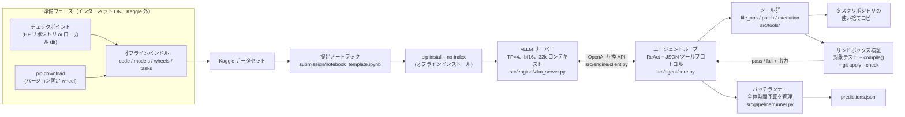

# アーキテクチャ — Gemma 4 Developer Agent（全体設計）

[English](architecture.md) | 日本語 · [README](../README.ja.md) に戻る

本ドキュメントは、本リポジトリの scaffold を全体設計へ展開したもので
す：コンペティションの要求、コンポーネントの関係、決定・実装済みの
事項、今後実装・堅牢化すべき事項、そしてインフラ／エージェントシス
テムリード（本リポジトリ）と ML／モデリングリード（共同作業者）の
役割分担をまとめます。

公式ルールで確認できる事実はそのように明記します。ルールページで
未確認の事項は **UNVERIFIED** と明示し、§10 に再掲します。

---

## 1. コンペティション制約（設計入力）

| 制約 | 値 / 前提 | 状態 |
| --- | --- | --- |
| 大会 | Gemma 4 Developer Agent Competition（Google DeepMind 主催、Kaggle） | 主催者により確定 |
| 採点環境 | Kaggle ノートブック、GPU インスタンス（L4x4 相当を想定） | GPU 種別は **UNVERIFIED** |
| 採点中のインターネット | 完全オフライン。ダウンロード・外部 API 不可 | 設計前提（ブリーフと一致） |
| 制限時間 | 合計12時間。vLLM 起動、ワークスペース準備、推論、検証を含む | 設計前提（ブリーフと一致） |
| 採点方式 | SWE-bench 形式：生成パッチをリポジトリに適用し、非公開テストスイートを実行、タスクごと Pass/Fail | 設計前提（ブリーフと一致） |
| タスク数 | 非公開の Python バグ修正 約120件 | **予算策定上の想定** — 正確な件数は **UNVERIFIED** |
| モデル | Gemma 4 ファミリーを vLLM でローカルサービング。事後学習は ML リード担当 | 方向性は確定 |
| 成果物 | タスクごとにパッチ1つを対応づけた predictions ファイル（正確なスキーマは **UNVERIFIED**、§10 参照） | **UNVERIFIED** |

以下すべてを形作る帰結：

- **実行時に何も取得できない。** 重み、トークナイザー、wheel、本
  コードは1つのオフラインバンドルとして配布します（§6）。
- **時計を管理するのはモデルではなくハーネス。** 1つの遅いタスク
  が残り約119件を飢えさせてはなりません（§3、§4）。
- **適用できないパッチはゼロ点。** 推論がどれほど良くても同じで
  す。検証は「解決」の定義の一部です（§4）。

## 2. システムアーキテクチャ



### 2.1 コンポーネントの責務

| コンポーネント | ファイル | 責務 |
| --- | --- | --- |
| 提出ノートブック | `submission/notebook_template.ipynb` | バンドル特定、オフラインインストール、サーバー起動、バッチ実行、predictions 出力。Kaggle が実行する唯一の入口 |
| vLLM ライフサイクル | `src/engine/vllm_server.py` | `configs/vllm_config.yaml` から vLLM の OpenAI 互換サーバーをサブプロセス起動し、`/health` を監視（上限900秒）、プロセスグループごと確実に停止 |
| LLM クライアント | `src/engine/client.py` | HTTP 経由の最小 OpenAI 互換チャットクライアント。標準ライブラリのみで実装し、追加 wheel の有無にサービングを依存させない |
| エージェントループ | `src/agent/core.py` | タスクごとの ReAct / Plan-and-Solve ループ。ステップ・トークン・時間の上限を強制し、モデルの JSON ツール呼び出しを解釈、失敗リカバリを担う |
| プロンプト | `src/agent/prompts.py` | システムプロンプト、厳密な JSON ツールプロトコル、Few-shot 例、インジェクション耐性ルール（リポジトリ本文はデータであり指示ではない） |
| コンテキストメモリ | `src/agent/memory.py` | トークン予算の管理とプルーニング：長いツール出力を先頭/末尾で切り詰め、予算超過時は古いターンから削除、直近ターンは常に逐語保持 |
| ファイルツール | `src/tools/file_ops.py` | `read_file`（行数上限付き）、一意アンカーによる `edit`、grep 形式の検索、AST 概要。対象リポジトリのルート外へは出られない |
| パッチツール | `src/tools/patch.py` | `git diff` で統一 diff を生成。pristine clone への `git apply --check` と、変更した全 `.py` の `compile()` で検証 |
| 実行ツール | `src/tools/execution.py` | タイムアウト付きサブプロセスでテスト/コマンドを実行。プロセスグループごと kill し、取得出力は上限付き（先頭＋末尾） |
| バッチランナー | `src/pipeline/runner.py` | 全体で1つの予算に対してタスクを反復。タスク間の汚染を防ぐためリポジトリはタスクごとの使い捨てコピー。予備時間内では新規タスクを開始しない |
| エクスポーター | `src/pipeline/exporter.py`、`scripts/build_submission.py` | バンドル（コード＋ノートブック＋重み＋wheel＋タスク）を Kaggle データセットのレイアウトに組み立てる |
| オフライン準備 | `scripts/setup_offline_deps.sh` | ネットワークを使う唯一のステップ：準備フェーズにバージョン固定 wheel とチェックポイント（`MODEL_ID` または `MODEL_LOCAL_DIR`）を取得 |

### 2.2 scaffold に実装済みの設計判断

1. **ネイティブ function calling ではなく JSON テキストプロトコ
   ル。** モデルは1ターンに JSON オブジェクトをちょうど1つ返しま
   す（ツール呼び出し、または `finish`）。理由：ベンダー形式の
   function calling で学習されていないベースライン重みでも動き、
   チェックポイント差し替えに強く、全ターンが完全にログに残り
   ます。
2. **クライアントは標準ライブラリのみ。** オフライン wheel セット
   が不完全でも、エージェントはサーバーと通信できます。
3. **決定論的な予算はプロンプトでなく設定で。** ステップ数（60）、
   タスクあたりトークン（400k）、タスクあたり時間（1800秒）、全
   体実行予算（41,400秒）はコードが強制するハードキャップです
   （`configs/default_agent.yaml`）。
4. **検証は後付けでなくループの一部。** 元の HEAD に clean に適用
   でき、変更した Python ファイルがすべてコンパイルできる場合の
   み「解決」とします（§4.3）。
5. **コンテキストは「溢れないこと」ではなくプルーニングで設計。**
   32k のサービングコンテキストは実リポジトリに対して小さいため、
   探索は選択的に行い（§4.2）、古い観測は圧縮します（§2.1
   memory）。
6. **タスクごとに使い捨てワークスペース。** ランナーはタスクごと
   にリポジトリをコピーします。破壊的な編集やハングしたテストが
   影響するのはそのタスクだけです。

### 2.3 今後実装・堅牢化するもの

- ループ検出：状態変化なく同じツール呼び出しを繰り返すタスクを
  中断または軌道修正する（§4.4）。
- 適応的なタスク予算：初期も終盤も一律1800秒ではなく、全体予算
  の消費に応じてタスク上限を縮小する（§3）。
- 失敗フィードバック付きリトライ：検証失敗の結果を、同一タスク
  予算内で1回だけboundedに修復試行へ戻す（§4.4）。
- シンボルグラフによるナビゲーション（AST 概要の先）。探索がボ
  トルネックだと resolve 率のデータが示した場合のみ（§7）。
- フリーズ前の本番長リハーサル（実 GPU、12時間枠、インターネッ
  ト OFF）（§9）。

## 3. 時間とリソースの予算

### 3.1 ウォールクロック（12時間 = 43,200秒）

| フェーズ | 予算 | 根拠 |
| --- | --- | --- |
| ノートブック準備＋オフラインインストール | 約600秒（10分） | バンドル済み wheel から `pip install --no-index` |
| vLLM 起動（ロード＋ウォームアップ） | 最大900秒（15分） | `startup_timeout_seconds` のヘルスチェック上限 |
| 全タスクのエージェント実行 | 41,400秒（約11.5時間） | `run.global_timeout_seconds` |
| predictions 生成＋予備 | 900秒（15分）を温存 | `run.reserve_seconds`。この時間内は新規タスクを開始しない |
| **合計** | **43,200秒（12時間）** | |

想定約120タスクでのタスクあたり計算：

- タスクあたりの平均利用可能時間：41,400 / 120 ≈ **345秒（約5.75
  分）**。
- タスク上限（1800秒）は*難しいタスクへの天井*であり権利ではあ
  りません。全タスクが上限まで走れば60時間必要です。したがって
  本システムは (a) 大半のタスクが `finish` により上限を大きく下
  回って終わること、(b) 予算を意識したスケジューリング、に依存
  します。
- **スケジューリング規則（実装予定、§2.3）：** タスク開始前に
  effective cap = min(1800秒, 残予算 / 残タスク数 × 2) とします。
  これにより、序盤のタスクに食われて終盤のタスクが飢える事態を
  防ぎ、終盤にも縮小しながら公平な配分が残ります。
- 未開始のタスクにも（空の）prediction 行を出します。時間超過は
  実行失敗ではなくカバレッジの部分低下に劣化します（空パッチの
  採点セマンティクスは **UNVERIFIED**、§10）。

### 3.2 GPU メモリ（L4x4 想定：4 × 24GB = 96GB）

現在のサービング設定（`configs/vllm_config.yaml`）：テンソル並列
4、bf16、`max_model_len` 32768、`gpu_memory_utilization` 0.90、
prefix caching 有効。

- **重み：** bf16 はパラメータあたり約2バイト。*P* 十億パラメータ
  のチェックポイントなら約 2*P* GB で、TP=4 により4 GPU に分割
  されます。Gemma 4 チェックポイントの正確なサイズは ML リード
  の成果物であり（§5）、ハーネスは重みディレクトリを不透明なも
  のとして扱います。
- **KV キャッシュ：** 重みを除いた残りメモリが vLLM の KV プール
  です。シーケンスあたり32k コンテキスト、かつタスクごとに逐次
  1シーケンスのため KV の圧迫は控えめです。prefix caching は、
  Issue 本文やリポジトリプロンプトがターン間で繰り返されるため
  効果があります。
- **bf16 と量子化のトレードオフ：**
  - bf16（デフォルト、`quantization: null`）：完全な忠実度で最
    大のフットプリント。チェックポイントが余裕をもって収まる
    間はこちらを優先します。
  - AWQ/GPTQ 4bit（パラメータあたり約0.5バイト＋スケール）：
    KV の余裕が大きく生まれ、デコードも高速化しえますが、パッ
    チ生成品質のリスクと、そのチェックポイント形式に対する
    vLLM カーネル対応への依存があります。ML リードが量子化
    チェックポイントを出荷し検証した場合にのみ採用し、ノート
    ブック内でオンザフライに量子化することは決してしません。
- **並行性：** 1サーバーに対し1タスクずつ。continuous batching
  で複数タスクを流すのはスループットの選択肢ですが、タスクご
  との分離と予算管理が複雑になります。リハーサルでデコードの
  アイドルが示された場合にのみ再検討します（§9）。

## 4. エージェント設計

### 4.1 ループポリシー

- `src/agent/core.py` の ReAct 形式ループ：思考 → JSON ツール呼
  び出し1つ → 観測 → 繰り返し。`finish`、上限到達、または失敗
  ポリシーの発動で終了します。
- タスクごとのハードキャップ：**60ステップ**、**400k トーク
  ン**、**1800秒**（§3.1 の適応あり）、1呼び出しあたり補完上限
  4096トークン、再現性のため temperature 0.2。
- 不正な返答：最大 `max_parse_errors: 3` 回まで修正再プロンプト
  （「JSON オブジェクトをちょうど1つ返せ」）を行い、それを超え
  たらタスクを部分パッチポリシー（§4.4）で終了します。

### 4.2 探索戦略

1. Issue 本文から開始し、可能性の高い識別子（エラー名、関数/ク
   ラス名、ファイルパス）を検索シードとして抽出します。
2. ファイルを丸読みせず、AST 概要ツールで安価なリポジトリマッ
   プ（モジュール、クラス、関数）を構築します。`read_file` は
   400行上限で、コンテキストは積極的にプルーニングされます。
3. シードに対する対象を絞った grep → 最小の内包スコープを読む
   → 仮説を立てる → 編集、の順に進みます。同じファイルの再読
   繰り返しはループの兆候として扱います（§4.4）。
4. Issue を説明できる最小の変更を優先します。広範なリファクタ
   リングはステップを浪費し、パッチ却下リスクを上げます。

### 4.3 編集と自己検証

- **一意アンカー編集：** 編集はファイル内にちょうど1回だけ出現
  するアンカー文字列を指定しなければなりません。曖昧なアン
  カーは一致件数とともにモデルへ差し戻します。これにより、同
  名の別関数を誤って書き換える典型的な失敗を防ぎます。
- 編集ラウンドごとにサンドボックスで自己検証します。順序は：
  1. 変更した全 `.py` ファイルを `compile()`。
  2. 最も関連するテストを実行（タスクのテストコマンドが分かれ
     ばそれ、なければ編集箇所に最も近いテストファイル）。実行
     ツールのタイムアウト下で実施。
  3. `finish` 前に diff を生成し、元の HEAD の pristine clone
     に対して `git apply --check`。
- ステップ3を通過した diff でのみ `finish` できます。通過しなけ
  れば、失敗出力を次の観測としてループを継続します。

### 4.4 失敗リカバリ

| 失敗 | ポリシー |
| --- | --- |
| JSON 形式の不正な返答 | 修正再プロンプト。3回（`max_parse_errors`）でタスク終了 |
| 同一ツール呼び出しの繰り返し / 状態変化なし | ループ検出が戦略メモを強制（「既知を要約し、別ファイルを選ぶか finish せよ」）。2回目でタスク終了 |
| ツール/コマンドのタイムアウト | 観測にタイムアウトを記録し、部分出力（先頭＋末尾）は保持。同一コマンドの再実行をモデルに禁じる |
| 検証が失敗し続ける | 失敗クラスごとに同一タスク予算内で bounded な修復を1サイクル。その後は部分パッチポリシー |
| タスク予算の枯渇 | **部分パッチポリシー：** 現在の diff が clean に適用できコンパイルできるならそのまま提出（部分修正でも非公開テストを通ることがある）。検証できない場合はそのタスクは空パッチを提出 |
| サーバークラッシュ / 実行中 OOM | ランナーがサーバーを1回再起動し、中断タスクを末尾に再キュー。2回目のクラッシュで実行を打ち切り、完了分すべての predictions を書き出す |

### 4.5 時間が余った場合の複数試行オプション

優先順位順。1周目の全タスク走行後に予算が証明可能に残っている
場合のみ：

1. **失敗タスクへの2周目。** 新しいコンテキストに、1周目の短い
   失敗サマリ（試したこと、検証の言い分）を添えて再挑戦。
2. **ニアミスへの best-of-n：** パッチは適用できたがローカルテ
   ストが僅差で落ちたタスクについて、temperature を少し上げて
   代替パッチを1つサンプリングし、ローカルチェックをより多く
   通った方を採用。ローカルで通っているパッチを未検証のものに
   置き換えることは決してしない。
3. タスクごとに複数回の全実行を要する投票方式は採用しません。
   タスク平均 約345秒の予算では不可能です。

## 5. ML / モデリングリードとのインタフェース契約

境界は意図的に薄くします：**重みディレクトリと設定ファイル2
つ**。それ以外はすべて本リポジトリの責務です。

### 5.1 ML リードからの期待成果物

| 項目 | 要件 |
| --- | --- |
| 重み | Hugging Face レイアウトのディレクトリ：`config.json`、`model*.safetensors`（シャード可）。コード変更なしに vLLM でロード可能であること |
| トークナイザー | `tokenizer.json` および/または `tokenizer_config.json`、必要なら `special_tokens_map.json`。チェックポイントの学習と一致していること |
| チャットテンプレート | `tokenizer_config.json` に埋め込み、または同一ディレクトリに `chat_template.jinja`。ハーネスはプレーンなチャットメッセージを送り、サービング側テンプレートに依存する |
| 生成デフォルト | チェックポイントがチューニングされた非デフォルトのサンプリングがあれば、`generation_config.json` に宣言するか、`configs/default_agent.yaml` 向けの設定値として引き渡す |
| 来歴メモ | ベースモデル ID、学習データ概要、ステップ数。レポート作成とフォールバック判断に必要 |

### 5.2 重みの差し込み方法

- 準備フェーズ（インターネット ON）：`MODEL_ID=<hf-repo>` で
  `models/gemma-4/` へダウンロード、または `MODEL_LOCAL_DIR=<path>`
  でローカルのファインチューニング出力を同場所へコピー
  （`scripts/setup_offline_deps.sh`）。
- バンドルは `models/gemma-4/` を含み、`configs/vllm_config.yaml`
  がそれを指します。環境変数 `GEMMA4_MODEL_PATH` で上書き可能。
- チェックポイント差し替えに**コード変更を要してはなりません**：
  同一ディレクトリレイアウト、同一 served name（`gemma-4`）。

### 5.3 受入ゲート（スモーク評価）

新しいチェックポイントは、以下すべてをローカルで通過した場合
にのみ受け入れます：

1. vLLM がロードし、起動予算内に `/health` がグリーンになる。
2. プロトコル遵守：固定プローブセット（スクリプト化プロンプト
   20件以上）で、返答の95%以上がちょうど1つの有効な JSON オブ
   ジェクトである。
3. スモーク resolve：スクリプト化デモタスクと小規模な公開タス
   クセット（§7）を end-to-end で完走し、有効なパッチを1つ以
   上生成する。
4. §7 のメトリクスセットで、前回受入済みチェックポイントに対
   する合意済み許容範囲を超える退行がない。

### 5.4 フォールバック

- **ベースライン Gemma 4 重み**（未チューニング）が常設の
  フォールバックであり、常にバンドル可能な状態を保ちます。
  ファインチューニングがフリーズ期間内（§9）に受入ゲートを通
  らなければ、提出は未検証チェックポイントではなくベースライ
  ンを出荷します。

## 6. オフラインバンドルと Kaggle パッケージング

### 6.1 バンドルレイアウト（Kaggle データセット）

```text
bundle/
├─ code/            本リポジトリ（src/、configs/、scripts/、submission/）
├─ models/gemma-4/  重み＋トークナイザー（§5）
├─ wheels/          Kaggle イメージにないものすべてのバージョン固定 wheel
└─ tasks/           主催者から提供されるタスク定義
```

### 6.2 wheel 戦略

- バージョンを完全固定し、準備フェーズに `pip download` で取得
  します（ネットワークを使う唯一のステップ）。
- Kaggle では `pip install --no-index --find-links wheels/` で
  インストールします。
- リスクの高い依存は vLLM 本体です（大きく、CUDA に敏感）。
  Kaggle イメージの vLLM をそのまま使うか、固定 wheel をバン
  ドルするかは、希望ではなくリハーサルで早期に決定します
  （§8）。ハーネスコード自体の実行時依存は PyYAML のみで、ク
  ライアントは標準ライブラリのみです。
- **UNVERIFIED：** 採点イメージに vLLM がプリインストールされ
  ているか、その CUDA/torch バージョン（§10）。

### 6.3 ノートブックの流れ

`submission/notebook_template.ipynb` の順序：`/kaggle/input` 配
下でバンドルを特定 → オフラインインストール → `src/engine/vllm_server.py`
で vLLM 起動 → ヘルスチェック待ち → タスクセットに対して
`src/pipeline/runner.py` を実行 → `/kaggle/working/predictions.jsonl`
を出力 → サーバー停止。各ステージでタイムスタンプをログし、リ
ハーサル実行で12時間の内訳が正確に分かるようにします。

### 6.4 サイズと上限への配慮

- Kaggle のデータセットおよびノートブック出力の上限がバンドル
  と `predictions.jsonl` に適用されます。正確な上限は
  **UNVERIFIED**（§10）であり、バンドル確定前に確認が必要です
  — 数 GB の重みディレクトリは、コード/wheel とは別のデータ
  セットに分ける必要があるかもしれません。
- バンドルに成果物を含めません：ログ、`artifacts/`、キャッシュ
  は除外します。

### 6.5 提出前チェックリスト（提出ビルドのたびに実行）

- [ ] バンドル対象の正確なコミットで `pytest` グリーン
- [ ] `scripts/run_local_eval.py --demo` グリーン（スクリプト駆動クライアント）
- [ ] チェックポイントが §5.3 受入ゲートを通過。フォールバック用ベースラインも配置済みでロード可能
- [ ] バンドルをクリーンな状態から再構築し、エクスポーターの `sha256` マニフェストを確認
- [ ] インターネット **OFF**・GPU ON で Kaggle 上 end-to-end リハーサル済み。12時間枠内に収まり predictions ファイルが出力された
- [ ] predictions ファイルのスキーマが主催者仕様と一致（§10 項目1）
- [ ] 設定フリーズ：フリーズ後に `configs/` への未レビュー差分なし

## 7. 評価計画

### 7.1 ローカルベンチマーク

- **公開 SWE-bench 形式タスク：** バージョン固定した公開バグ修
  正タスクのセット（公開 SWE-bench 形式リリースや fastapi/rich
  系の小規模 OSS リポジトリから抽出）を、ランナー形式の
  `tasks.json` として保持します。一度採用したらセットは固定
  し、チェックポイント間で数値を比較可能にします。
- ローカルと Kaggle で同じランナー・同じ設定を使います。ロー
  カル実行はタスク数を減らすことはあっても、コードパスを変え
  ることは決してしません。
- 公開タスクに可視テストが付属する場合、resolve = パッチ適用
  ＋そのテスト通過。付属しない場合、resolve = 適用＋コンパイ
  ル＋ハーネスが選んだ対象テスト通過（弱いシグナルとしてレ
  ポートに明記）。

### 7.2 追跡するメトリクス（実行ごと、チェックポイントごと）

| メトリクス | 意味 |
| --- | --- |
| Resolve 率（公開セット） | 品質の主要シグナル。スコアの方向を予測する唯一の数値 |
| 無効パッチ率（適用/コンパイル失敗） | ~0 へ収束させるべきもの。無効パッチはすべて確実なゼロ点 |
| タスクあたり平均ステップ / トークン | 予算のコスト側。§3 のスケジューリング規則を駆動する |
| タイムアウト率（タスク上限到達） | 高い値は探索の迷走かテストの遅さを示す |
| パースエラー率（JSON 形式不正） | チェックポイントのプロトコル遵守度。§5.3 ゲートに供給する |
| タスクあたりウォールクロック（p50 / p95） | 120タスクが枠内に収まることのリハーサル証拠 |

### 7.3 提出前の回帰ゲート

- バンドル対象の正確なチェックポイントでスモークゲート
  （§5.3）がグリーン。
- 公開セットの resolve 率が、前回フリーズ済みベースラインを
  合意済み許容範囲を超えて下回らない。無効パッチ率は ~0。
- 時間枠内での完全なリハーサルが1回あること（§6.5）。
  オフラインで end-to-end 完走したことのない実行は、部分的な
  数値がどうあれ提出不可。

## 8. リスク登録簿

| # | リスク | 影響 | 緩和策 | 担当 |
| --- | --- | --- | --- | --- |
| R1 | オフライン依存の欠落：採点イメージで wheel（特に vLLM/CUDA）が不足または不一致 | 実行が開始できず全損 | wheel を固定しバンドル。vLLM のイメージ採用か wheel 同梱かはリハーサルで決定。標準ライブラリのみのクライアントで表面積を最小化 | インフラ |
| R2 | Gemma 4 に対する vLLM 対応の未熟さ（ロードエラー、チャットテンプレートやツール形式の癖） | サーバー起動失敗または出力劣化 | JSON テキストプロトコル（function calling 非依存）。実チェックポイントの早期ロードテスト。vLLM バージョン固定 | インフラ + ML |
| R3 | 大規模リポジトリでのコンテキスト溢れ（32k サービングウィンドウ） | エージェントの空転、タイムアウト、無効パッチ | AST 優先の探索、読み取り上限、プルーニング（§4.2）。`max_model_len` の引き上げは KV 余裕の証拠がある場合のみ | インフラ |
| R4 | 時間超過：遅いタスクがタスクセットの尾を飢えさせる | 後半タスクが空 prediction になる | 全体予算＋適応キャップ＋予備時間（§3.1）。未開始タスクにも空行を出力 | インフラ |
| R5 | パッチ形式エラー（HEAD で diff が適用できない） | 影響タスクは確実にゼロ点 | finish 前に pristine clone で `git apply --check`。一意アンカー編集。部分パッチポリシー | インフラ |
| R6 | ファインチューニングがベースライン未満、または JSON プロトコルを壊す | 未チューニングのフォールバックよりスコアが下がる | プロトコル遵守しきい値つき §5.3 受入ゲート。ベースラインは常にバンドル可能に維持（§5.4） | ML（ゲート：インフラ） |
| R7 | Kaggle 環境ドリフト（イメージ、GPU 種別、上限がリハーサルと異なる） | 起動失敗または OOM | GPU/上限は定数でなく変数として扱う。明確なログつき起動時セルフチェック。メモリが厳しい場合の量子化フォールバックを ML が準備 | インフラ + ML |
| R8 | チーム/事務の締切ミス（マージまたは提出） | 品質によらず失格 | §9 のロードマップは2つのハード締切から逆算。事務手続きは1週間前に完了 | 両者 |

## 9. ロードマップ（すべて JST）

ハード締切：**チームマージ — 2026-11-26 08:59 JST**、**最終提
出 — 2026-12-03 08:59 JST**。

| フェーズ | 期間 | 終了条件 |
| --- | --- | --- |
| 0. Scaffold | 完了（2026-10-31） | ハーネス、検証、パッケージング、テストがグリーン（本リポジトリ v0.1） |
| 1. ベースライン end-to-end | 11月上旬 | ベースライン Gemma 4 重みが vLLM でロード可能。スクリプト駆動＋実モデル実行がローカルで完走。公開セットの初回数値を記録（§7） |
| 2. Kaggle リハーサル #1 | 11月上旬〜中旬 | 削減タスクセットで Kaggle 上の全フロー（インターネット OFF）が完走。ステージごとの時間を計測。vLLM のイメージ採用か wheel 同梱かを決定（R1） |
| 3. チェックポイント統合 v1 | 11月中旬 | ML リードの初回チェックポイントが §5.3 ゲートを通過。公開セットでベースラインと A/B。失敗ログからプロンプト/設定をチューニング |
| 4. 堅牢化 | 11月中旬〜下旬 | ループ検出、適応予算、失敗フィードバック付きリトライ（§2.3）。公開セットで無効パッチ率 ~0 |
| 5. チームマージ完了 | 2026-11-26 08:59 まで | Kaggle のチームがマージされ、大会ページで確認済み（事務、R8） |
| 6. フルリハーサル | 11月下旬 | フリーズ済みバンドルで Kaggle 上の12時間枠完走を1回。predictions 出力。時間に余裕をもって収まる |
| 7. フリーズ | 2026-11-30 頃 | コード＋設定＋チェックポイントをフリーズ。以後はブロッキングバグ修正のみで、各修正は再ゲート（§7.3） |
| 8. 最終提出 | 2026-12-03 08:59 まで | フリーズ済みバンドルから §6.5 チェックリストで提出物を構築。1日の余裕をもって提出 |

## 10. 未確認事項 / 検証すべき前提

以下はいずれも、公式ルールページ（または主催者アナウンス）で確
認してから設計が依存すべき事項です。**本セクションの内容は確定
した事実ではありません。**

1. **UNVERIFIED — predictions スキーマ：** 正確なファイル名、形
   式（JSONL か CSV か）、タスクごとの必須フィールド、タスクの
   識別方法。§6 は `predictions.jsonl` を想定し、変更が必要な
   場合はエクスポーターの1箇所で吸収します。
2. **UNVERIFIED — タスクセット：** 非公開タスクの正確な件数
   （予算策定上 約120件と想定）、リポジトリのサイズ、タスクリ
   ポジトリがノートブック環境の一部として届くのか提供データ
   セットなのか。
3. **UNVERIFIED — ハードウェア：** 保証される GPU 種別/個数
   （L4x4 を想定）、GPU あたり VRAM、12時間上限が大会ルールな
   のか Kaggle の標準セッション上限なのか。
4. **UNVERIFIED — 環境：** インターネット無効化が大会によるも
   のかノートブック設定によるものか、ベースイメージのプリイン
   ストール内容（vLLM の有無、torch/CUDA バージョン）、データ
   セット/出力のサイズ上限（§6.4）。
5. **UNVERIFIED — 採点詳細：** 空/欠落パッチが単なる fail とし
   て採点されるか（想定はそう）、部分点の有無、タイ/順位の決
   定方法。
6. **UNVERIFIED — モデルルール：** 許可される Gemma 4 チェック
   ポイント、事後学習が必須か任意か、重みに付随するライセン
   ス/利用条件。
7. **UNVERIFIED — 外部リソース：** 公開データセット、公開コー
   ド、任意サイズの事前ダウンロード wheel が許可されるか。提
   出に関する Kaggle データセットの公開設定要件。
8. **UNVERIFIED — チームルール：** §9 の2つの締切以外の、最大
   チームサイズとマージの仕組み。

項目が検証できたら、本セクションと影響する設計セクションを、同
一コミットで本ドキュメントの両言語版について更新してください。
