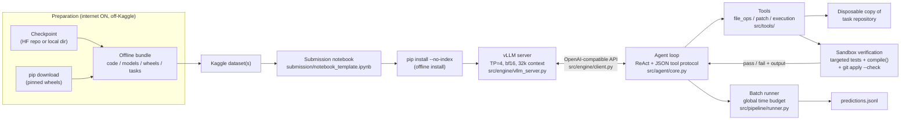

# Architecture — Gemma 4 Developer Agent (Overall Design)

English | [日本語](architecture.ja.md) · Back to [README](../README.md)

This document expands the scaffold in this repository into the full
system design: what the competition demands, how the pieces fit, what is
already decided and built, what remains to implement or harden, and how
the work is split between the Infra / Agent Systems Lead (this repo) and
the ML / Modeling Lead (teammate).

Where a fact comes from the official competition rules, it is stated as
such. Anything not yet confirmed against the rules page is marked
**UNVERIFIED** and collected again in §10.

---

## 1. Competition constraints (design inputs)

| Constraint | Value / assumption | Status |
| --- | --- | --- |
| Event | Gemma 4 Developer Agent Competition (Google DeepMind, on Kaggle) | Confirmed by organizers |
| Scoring environment | Kaggle notebook, GPU instance (L4x4 class assumed) | GPU type **UNVERIFIED** |
| Internet during scoring | Fully offline. No downloads, no external APIs | Design assumption, matches brief |
| Wall clock | 12 h total, including vLLM startup, workspace prep, inference, and verification | Design assumption, matches brief |
| Scoring method | SWE-bench style: generated patch is applied to the repo, hidden test suite is run, Pass/Fail per task | Design assumption, matches brief |
| Task set | ~120 hidden Python bug-fix tasks | **Assumption for budgeting** — exact count **UNVERIFIED** |
| Model | Gemma 4 family, served locally with vLLM; post-trained by the ML lead | Confirmed direction |
| Deliverable | A predictions file mapping each task to one patch (exact schema **UNVERIFIED**, see §10) | **UNVERIFIED** |

Consequences that shape everything below:

- **Nothing may be fetched at run time.** Weights, tokenizer, wheels,
  and this code ship as one offline bundle (§6).
- **The harness, not the model, owns the clock.** A single slow task
  must never be able to starve the remaining ~119 (§3, §4).
- **A patch that does not apply is worth zero**, no matter how good the
  reasoning was. Validation is part of the definition of "solved" (§4).

## 2. System architecture



### 2.1 Component responsibilities

| Component | File(s) | Responsibility |
| --- | --- | --- |
| Submission notebook | `submission/notebook_template.ipynb` | Locate the bundle, offline-install, start the server, run the batch, write predictions. The only entry point Kaggle executes. |
| vLLM lifecycle | `src/engine/vllm_server.py` | Spawn the vLLM OpenAI-compatible server as a subprocess from `configs/vllm_config.yaml`, poll `/health` (900 s cap), shut the process group down cleanly. |
| LLM client | `src/engine/client.py` | Minimal OpenAI-compatible chat client over HTTP. Standard library only, so serving never depends on an extra wheel being present. |
| Agent loop | `src/agent/core.py` | One ReAct / plan-and-solve loop per task. Enforces step, token, and wall-clock caps; parses the model's JSON tool calls; owns failure recovery. |
| Prompts | `src/agent/prompts.py` | System prompt, strict JSON tool protocol, few-shot examples, injection-resistance rules (repo text is data, never instructions). |
| Context memory | `src/agent/memory.py` | Token-budget accounting and pruning: truncate long tool outputs head/tail, drop oldest turns beyond the budget, always keep the most recent turns verbatim. |
| File tools | `src/tools/file_ops.py` | `read_file` (line-capped), unique-anchor `edit`, grep-style search, AST outline. Hard-confined to the task repo root. |
| Patch tools | `src/tools/patch.py` | Produce the unified diff via `git diff`; validate on a pristine clone (`git apply --check`) and `compile()` every touched `.py` file. |
| Execution tool | `src/tools/execution.py` | Run tests/commands in a subprocess with a timeout, process-group kill, and bounded (head+tail) captured output. |
| Batch runner | `src/pipeline/runner.py` | Iterate tasks against one global budget; give each task a disposable repo copy so tasks cannot contaminate each other; stop starting new tasks inside the reserve window. |
| Exporter | `src/pipeline/exporter.py`, `scripts/build_submission.py` | Assemble the bundle (code + notebook + weights + wheels + tasks) into Kaggle-dataset layout. |
| Offline prep | `scripts/setup_offline_deps.sh` | The only networked step: fetch pinned wheels and the checkpoint (`MODEL_ID` or `MODEL_LOCAL_DIR`) during preparation. |

### 2.2 Design decisions already embodied in the scaffold

1. **JSON text tool protocol, not native function calling.** The model
   emits exactly one JSON object per turn (a tool call or `finish`).
   Rationale: works with baseline weights that were never trained for
   the vendor function-calling format, survives checkpoint swaps, and
   every turn is fully loggable for post-mortems.
2. **Standard-library-only client.** If the offline wheel set is
   incomplete, the agent can still talk to the server.
3. **Deterministic budgets in config, not in prompts.** Steps (60),
   per-task tokens (400k), per-task time (1800 s), and the global run
   budget (41,400 s) are hard caps enforced by code
   (`configs/default_agent.yaml`).
4. **Validation is part of the loop, not an afterthought.** A task is
   only "solved" when the diff applies cleanly at the original HEAD and
   every touched Python file compiles (§4.3).
5. **Context pruning instead of context hope.** 32k served context is
   small against real repositories; exploration is selective by design
   (§4.2) and old observations are pruned (§2.1, memory).
6. **Disposable workspace per task.** The runner copies the repo per
   task; a destructive edit or a hung test can only kill that task.

### 2.3 What remains to build / harden

- Loop detection: abort or redirect a task that repeats the same tool
  call without state change (§4.4).
- Adaptive per-task budget: shrink the per-task cap as the global
  budget depletes, instead of a flat 1800 s for early and late tasks
  alike (§3).
- Failure-feedback retry: feed a failing verification result back for
  one bounded repair attempt inside the same task budget (§4.4).
- Symbol-graph navigation (beyond AST outline) if resolve-rate data
  says exploration is the bottleneck (§7).
- A full-length Kaggle rehearsal run (real GPU, real 12 h envelope,
  internet off) before freeze (§9).

## 3. Time and resource budget

### 3.1 Wall clock (12 h = 43,200 s)

| Phase | Budget | Basis |
| --- | --- | --- |
| Notebook setup + offline install | ~600 s (10 min) | `pip install --no-index` from bundled wheels |
| vLLM startup (load + warm) | up to 900 s (15 min) | `startup_timeout_seconds` health cap |
| Agent execution, all tasks | 41,400 s (~11.5 h) | `run.global_timeout_seconds` |
| Predictions packaging + reserve | 900 s (15 min), kept unspent | `run.reserve_seconds`; no new task starts inside it |
| **Total** | **43,200 s (12 h)** | |

Per-task arithmetic at the assumed ~120 tasks:

- Average available per task: 41,400 / 120 ≈ **345 s (~5.75 min)**.
- The per-task cap (1800 s) is a *ceiling for hard tasks*, not an
  entitlement: if every task ran to the cap the run would need 60 h.
  The system therefore relies on (a) most tasks finishing far below the
  cap via the `finish` action, and (b) budget-aware scheduling.
- **Scheduling rule (to implement, §2.3):** before starting a task,
  effective cap = min(1800 s, remaining_budget / remaining_tasks × 2).
  This guarantees late tasks still get a fair, shrinking slice instead
  of being starved by early ones.
- Tasks never started still get an (empty) prediction row, so a time
  overrun degrades to partial coverage instead of a failed run
  (empty-patch scoring semantics **UNVERIFIED**, §10).

### 3.2 GPU memory (L4x4 assumed: 4 × 24 GB = 96 GB)

Current serving config (`configs/vllm_config.yaml`): tensor parallel 4,
bf16, `max_model_len` 32768, `gpu_memory_utilization` 0.90, prefix
caching on.

- **Weights:** bf16 costs ~2 bytes/parameter. For a checkpoint of
  *P* billion parameters that is ~2*P* GB, sharded across the 4 GPUs by
  TP=4. Exact Gemma 4 checkpoint sizes are the ML lead's deliverable
  (§5); the harness treats the weights directory as opaque.
- **KV cache:** whatever memory remains after weights is vLLM's KV
  pool. At 32k context per sequence and one sequence at a time (the
  agent is sequential per task), KV pressure is modest; prefix caching
  pays off because issue text and repo prompts repeat across turns.
- **bf16 vs quantization trade-off:**
  - bf16 (default, `quantization: null`): full fidelity, largest
    footprint. Preferred while the checkpoint fits comfortably.
  - AWQ/GPTQ 4-bit (~0.5 byte/param + scales): frees large KV headroom
    and can speed decode, but risks patch-generation quality and
    depends on vLLM kernel support for the exact checkpoint format.
    Only adopt if the ML lead ships and validates a quantized
    checkpoint; never quantize on the fly inside the notebook.
- **Concurrency:** one task at a time against one server. Batching
  multiple tasks through continuous batching is a possible throughput
  lever, but it complicates per-task isolation and budgets; revisit
  only if the rehearsal run shows decode-bound idleness (§9).

## 4. Agent design

### 4.1 Loop policy

- ReAct-style loop in `src/agent/core.py`: think → one JSON tool call →
  observation → repeat, until `finish`, a cap, or a failure policy
  fires.
- Hard caps per task: **60 steps**, **400k tokens**, **1800 s**
  (adaptive per §3.1), completion cap 4096 tokens/call,
  temperature 0.2 for reproducibility.
- Malformed replies: up to `max_parse_errors: 3` corrective re-prompts
  ("reply with exactly one JSON object"), then the task aborts to its
  partial-patch policy (§4.4).

### 4.2 Exploration strategy

1. Start from the issue text; extract likely identifiers (error names,
   function/class names, file paths) as search seeds.
2. Build a cheap repo map with the AST outline tool (modules, classes,
   functions) instead of reading files wholesale; `read_file` is
   line-capped (400 lines) and context is pruned aggressively.
3. Targeted grep for the seeds, read the smallest enclosing scope,
   form a hypothesis, then edit. Re-reading the same file repeatedly is
   treated as a loop smell (§4.4).
4. Prefer the smallest change that explains the issue; broad refactors
   burn steps and raise patch-rejection risk.

### 4.3 Edit and self-verification

- **Unique-anchor edits:** an edit must name an anchor string occurring
  exactly once in the file; ambiguous anchors are rejected back to the
  model with the match count. This prevents the classic
  wrong-function-same-name patch.
- After each edit round, self-verify in the sandbox, in order:
  1. `compile()` every touched `.py` file.
  2. Run the most relevant tests (task's test command if known, else
     the test files nearest the edit) under the execution tool's
     timeout.
  3. Before `finish`: generate the diff and `git apply --check` it
     against a pristine clone of the original HEAD.
- A task may only `finish` with a diff that passed step 3; otherwise the
  loop continues with the failure output as the next observation.

### 4.4 Failure recovery

| Failure | Policy |
| --- | --- |
| Malformed JSON reply | Corrective re-prompt; abort task after 3 (`max_parse_errors`) |
| Repeated identical tool call / no state change | Loop detector forces a strategy note ("summarize what you know, pick a different file or finish"); second strike ends the task |
| Tool/command timeout | Observation records the timeout; the partial output (head+tail) is kept; the model is told not to rerun the identical command |
| Verification keeps failing | One bounded repair cycle per failure class inside the same task budget; then partial-patch policy |
| Task budget exhausted | **Partial-patch policy:** if the current diff applies cleanly and compiles, submit it as-is (a partial fix can still pass hidden tests); if it does not validate, submit an empty patch for that task |
| Server crash / OOM mid-run | Runner restarts the server once and requeues the interrupted task at the end; a second crash aborts the run and writes predictions for everything completed so far |

### 4.5 If time remains: multi-attempt options

In priority order, only with budget provably left after a full first
pass:

1. **Second pass over failed tasks** with a fresh context plus a short
   failure summary from pass 1 (what was tried, what verification said).
2. **Best-of-n on near-misses:** for tasks whose patch applied but whose
   local tests failed narrowly, sample one alternative patch at a
   slightly higher temperature and keep whichever passes more local
   checks. Never replace a locally-passing patch with an untested one.
3. No voting scheme that requires multiple full runs per task: at
   ~345 s average per task there is no budget for it.

## 5. Interface contract with the ML / Modeling Lead

The boundary is deliberately thin: **a weights directory and the two
config files.** Everything else is this repo's problem.

### 5.1 Expected deliverables from the ML lead

| Item | Requirement |
| --- | --- |
| Weights | Hugging Face layout directory: `config.json`, `model*.safetensors` (sharded is fine), loadable by vLLM without code changes |
| Tokenizer | `tokenizer.json` and/or `tokenizer_config.json`, `special_tokens_map.json` if used; tokenizer must match the checkpoint's training |
| Chat template | Embedded in `tokenizer_config.json` or a `chat_template.jinja` in the same directory; the harness sends plain chat messages and relies on the served template |
| Generation defaults | Any non-default sampling the checkpoint was tuned for, declared in `generation_config.json` or handed over as config values for `configs/default_agent.yaml` |
| Provenance note | Base model id, training data summary, and step count — needed for the write-up and for fallback decisions |

### 5.2 How weights drop in

- Preparation time (internet on): `MODEL_ID=<hf-repo>` downloads into
  `models/gemma-4/`, or `MODEL_LOCAL_DIR=<path>` copies a local
  fine-tune output to the same place (`scripts/setup_offline_deps.sh`).
- The bundle carries `models/gemma-4/`; `configs/vllm_config.yaml`
  points at it, overridable via the `GEMMA4_MODEL_PATH` env var.
- A checkpoint swap must require **zero code changes**: same directory
  layout, same served name (`gemma-4`).

### 5.3 Acceptance gate (smoke eval)

A new checkpoint is accepted only if all of these pass locally:

1. vLLM loads it and `/health` is green within the startup budget.
2. Protocol compliance: over a fixed probe set (≥20 scripted prompts),
   ≥95% of replies are exactly one valid JSON object.
3. Smoke resolve: the scripted demo tasks plus a small public-task set
   (§7) complete end-to-end and produce at least one valid patch.
4. No regression vs the previous accepted checkpoint on the §7 metric
   set beyond the agreed tolerance.

### 5.4 Fallback

- The **baseline Gemma 4 weights** (untuned) are the standing fallback
  and are kept bundle-ready at all times. If a fine-tune fails the
  acceptance gate inside the freeze window (§9), the submission ships
  the baseline rather than an unvalidated checkpoint.

## 6. Offline bundle and Kaggle packaging

### 6.1 Bundle layout (Kaggle dataset)

```text
bundle/
├─ code/            this repository (src/, configs/, scripts/, submission/)
├─ models/gemma-4/  weights + tokenizer (§5)
├─ wheels/          pinned wheels for everything not in the Kaggle image
└─ tasks/           task definitions as provided by the organizers
```

### 6.2 Wheels strategy

- Pin exact versions; fetch with `pip download` during preparation
  (the only networked step).
- Install on Kaggle with `pip install --no-index --find-links wheels/`.
- The risky dependency is vLLM itself (large, CUDA-sensitive). Decide
  early — by rehearsal, not by hope — whether the Kaggle image's vLLM
  is used as-is or a pinned wheel is bundled (§8). The harness code
  itself needs only PyYAML at runtime; the client is stdlib-only.
- **UNVERIFIED:** whether the scoring image preinstalls vLLM and which
  CUDA/torch versions it carries (§10).

### 6.3 Notebook flow

`submission/notebook_template.ipynb`, in order: locate bundle under
`/kaggle/input` → offline install → start vLLM via
`src/engine/vllm_server.py` → wait for health → run
`src/pipeline/runner.py` over the task set → write
`/kaggle/working/predictions.jsonl` → stop the server. Every stage logs
timestamps so a rehearsal run shows exactly where the 12 h went.

### 6.4 Size and limits awareness

- Kaggle dataset and notebook output limits apply to the bundle and to
  `predictions.jsonl`; exact caps are **UNVERIFIED** (§10) and must be
  checked before the bundle is finalized — a multi-GB weights directory
  may need its own dataset separate from code/wheels.
- Keep artifacts out of the bundle: no logs, no `artifacts/`, no caches.

### 6.5 Pre-flight checklist (run before every submission build)

- [ ] `pytest` green on the exact commit being bundled
- [ ] `scripts/run_local_eval.py --demo` green (scripted client)
- [ ] Checkpoint passed the §5.3 acceptance gate; fallback baseline also
      staged and loadable
- [ ] Bundle rebuilt from clean state; `sha256` manifest from the
      exporter reviewed
- [ ] Notebook rehearsed end-to-end on Kaggle with internet **off** and
      GPU on, inside the 12 h envelope, predictions file written
- [ ] Predictions file schema matches the organizer spec (§10 item 1)
- [ ] Configs frozen: no unreviewed diff in `configs/` after freeze

## 7. Evaluation plan

### 7.1 Local benchmark

- **Public SWE-bench-style tasks:** a fixed, versioned set of public
  bug-fix tasks (e.g. drawn from public SWE-bench-style releases and
  small OSS repos such as fastapi/rich-style codebases), stored as
  `tasks.json` in the runner's format. The set is frozen once adopted
  so numbers are comparable across checkpoints.
- The same runner and the same configs are used locally and on Kaggle;
  local runs may use fewer tasks but never different code paths.
- Where a public task ships visible tests, resolve = patch applies +
  those tests pass. Where it does not, resolve = applies + compiles +
  targeted tests the harness selects pass (weaker signal, labeled as
  such in reports).

### 7.2 Metrics to track (per run, per checkpoint)

| Metric | Why it matters |
| --- | --- |
| Resolve rate (public set) | Headline quality signal; the only number that predicts score direction |
| Invalid patch rate (fails apply/compile) | Must trend to ~0; every invalid patch is a guaranteed zero |
| Average steps / tokens per task | Cost side of the budget; drives the §3 scheduling rule |
| Timeout rate (task cap hit) | High values mean exploration is wandering or tests are slow |
| Parse-error rate (malformed JSON) | Protocol compliance of the checkpoint; feeds the §5.3 gate |
| Wall-clock per task (p50 / p95) | Rehearsal evidence that 120 tasks fit the envelope |

### 7.3 Regression gates before submission

- Smoke gate (§5.3) green on the exact bundled checkpoint.
- Public-set resolve rate not below the last frozen baseline by more
  than the agreed tolerance; invalid patch rate at ~0.
- One full rehearsal inside the time envelope (§6.5). A run that has
  never completed end-to-end offline is not submittable, whatever its
  partial numbers say.

## 8. Risk register

| # | Risk | Impact | Mitigation | Owner |
| --- | --- | --- | --- | --- |
| R1 | Offline dependency gap: a wheel (esp. vLLM/CUDA) missing or mismatched in the scoring image | Run never starts; total loss | Pin and bundle wheels; decide image-vs-bundle vLLM by rehearsal; stdlib-only client minimizes surface | Infra |
| R2 | vLLM support for Gemma 4 immature (load errors, chat template or tool-format quirks) | Server fails or outputs degrade | JSON text protocol (no function-calling dependency); early load test of the real checkpoint; pinned vLLM version | Infra + ML |
| R3 | Context overflow on large repos (32k served window) | Agent thrashes, timeouts, invalid patches | AST-first exploration, capped reads, pruning (§4.2); raise `max_model_len` only with KV headroom evidence | Infra |
| R4 | Time overrun: slow tasks starve the tail of the task set | Later tasks get empty predictions | Global budget + adaptive caps + reserve (§3.1); empty rows for unstarted tasks | Infra |
| R5 | Patch format errors (diff doesn't apply at HEAD) | Guaranteed zero per affected task | Pristine-clone `git apply --check` before finish; unique-anchor edits; partial-patch policy | Infra |
| R6 | Fine-tune underperforms baseline or breaks JSON protocol | Score below the no-tune fallback | §5.3 acceptance gate with protocol-compliance threshold; baseline always bundle-ready (§5.4) | ML (gate: Infra) |
| R7 | Kaggle environment drift (image, GPU type, limits differ from rehearsal) | Startup failure or OOM | Treat GPU/limits as variables, not constants; startup self-checks with clear logs; quantization fallback prepared by ML if memory is tight | Infra + ML |
| R8 | Team/administrative miss (merger or submission deadline) | Disqualification regardless of quality | §9 roadmap works backwards from the two hard deadlines; admin completed a week early | Both |

## 9. Roadmap (all times JST)

Hard deadlines: **team merger — 2026-11-26 08:59 JST**;
**final submission — 2026-12-03 08:59 JST**.

| Phase | Window | Exit criteria |
| --- | --- | --- |
| 0. Scaffold | Done (2026-10-31) | Harness, validation, packaging, tests green (this repo, v0.1) |
| 1. Baseline end-to-end | Early Nov | Baseline Gemma 4 weights load via vLLM; scripted + real-model runs complete locally; first public-set numbers recorded (§7) |
| 2. Kaggle rehearsal #1 | Early–mid Nov | Notebook runs the full flow on Kaggle, internet off, on a reduced task set; timing per stage measured; vLLM image-vs-wheel decision closed (R1) |
| 3. Checkpoint integration v1 | Mid Nov | First ML-lead checkpoint through the §5.3 gate; A/B vs baseline on the public set; prompt/config tuning from failure logs |
| 4. Hardening | Mid–late Nov | Loop detection, adaptive budgets, failure-feedback retry (§2.3); invalid patch rate ~0 on the public set |
| 5. Team merger complete | By 2026-11-26 08:59 | Kaggle team merged and verified on the competition page (admin, R8) |
| 6. Full rehearsal | Late Nov | One complete 12 h-envelope run on Kaggle with the frozen bundle; predictions written; timing fits with margin |
| 7. Freeze | ~2026-11-30 | Code + configs + checkpoint frozen; only blocking-bug fixes afterwards, each re-gated (§7.3) |
| 8. Final submission | By 2026-12-03 08:59 | Submission built from the frozen bundle via §6.5 checklist; submitted with a day to spare |

## 10. Open questions / assumptions to verify

Each item below must be checked against the official competition rules
page (or organizer announcements) before the design relies on it.
**Nothing in this section is established fact.**

1. **UNVERIFIED — predictions schema:** exact file name, format
   (JSONL? CSV?), required fields per task, and how tasks are
   identified. §6 assumes `predictions.jsonl`; the exporter is the
   single place that would change.
2. **UNVERIFIED — task set:** exact number of hidden tasks (~120
   assumed for budgeting), repo sizes, and whether task repos arrive
   as part of the notebook environment or a provided dataset.
3. **UNVERIFIED — hardware:** guaranteed GPU type/count (L4x4
   assumed), VRAM per GPU, and whether the 12 h cap is a competition
   rule or the standard Kaggle session limit.
4. **UNVERIFIED — environment:** whether internet is disabled by the
   competition or by notebook setting, what the base image preinstalls
   (vLLM? torch/CUDA versions), and dataset/output size caps (§6.4).
5. **UNVERIFIED — scoring details:** whether an empty/missing patch is
   scored as a plain fail (assumed), whether partial credit exists,
   and how ties/ranks are computed.
6. **UNVERIFIED — model rules:** which Gemma 4 checkpoints are
   permitted, whether post-training is required or optional, and any
   license/usage terms attached to the weights.
7. **UNVERIFIED — external resources:** whether public datasets,
   public code, and pre-downloaded wheels of arbitrary size are
   allowed, and any Kaggle dataset visibility requirements for the
   submission.
8. **UNVERIFIED — team rules:** maximum team size and merger mechanics
   beyond the two deadlines in §9.

When an item is verified, update this section and the affected design
section in the same commit, in both language versions of this document.
